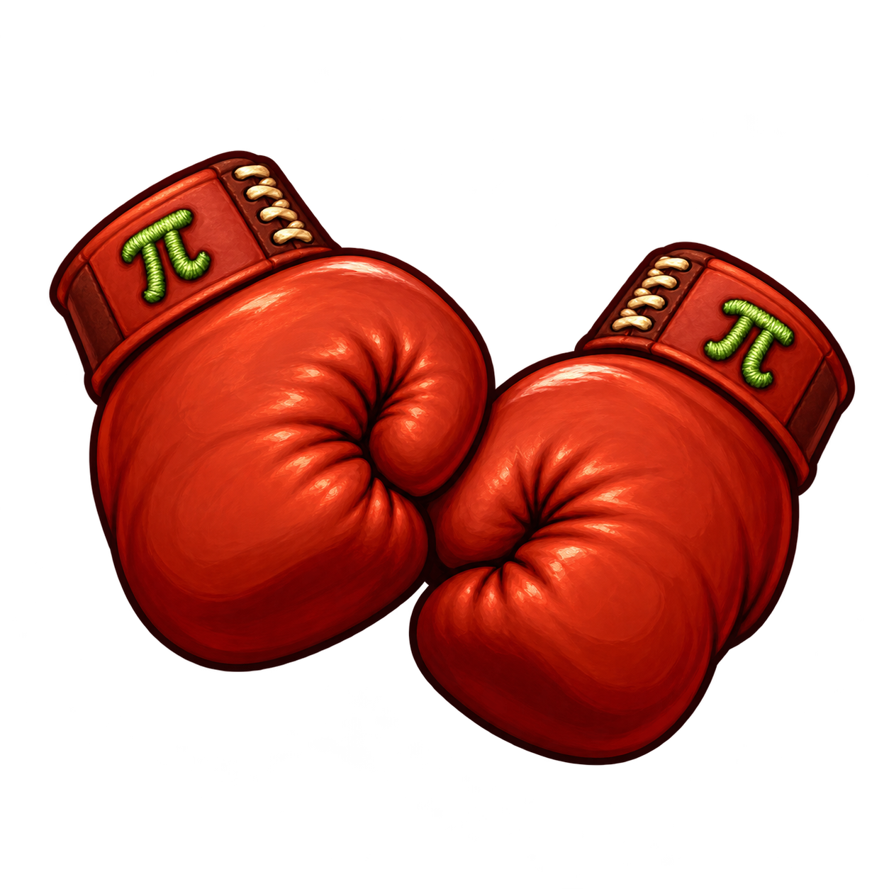

<p align="center"></p>

# Boxer, carried forward

DOS games on a Mac should still feel like Mac apps. Boxer wraps DOS software in
click-to-play gameboxes, with a Finder-friendly library and sensible defaults
for sound, graphics, and controls. This is the **thec0de.com continuation** of
Boxer, built on [MaddTheSane's fork](https://github.com/MaddTheSane/Boxer) of
[Alun Bestor's original](https://github.com/alunbestor/Boxer).

## 4.2.0 Beta

The current beta is a universal Intel and Apple Silicon build targeting
macOS 12 or newer. It includes the original Epic Pinball, Ultima Underworld,
and X-COM demo gameboxes, with an optional first-run copy into your games
folder. You can import your own DOS software separately.

This beta is **ad-hoc signed, not Developer ID signed or notarized**. macOS may
require manual approval on first launch. Intel Macs, macOS 12-25, and the
owner's M3 Pro have not yet received hardware qualification; the target alone
is not a compatibility guarantee. Older Boxer builds remain available at
[boxer.thec0de.com](https://boxer.thec0de.com/).

### What changed

- Restored Boxer's established `net.washboardabs.boxer` app identity.
- Applied the saved-gamebox-path and shell-readiness fix from upstream
  [pull request #82](https://github.com/MaddTheSane/Boxer/pull/82).
- Kept the original sample demos and bundled DOS Toolkit, including Gravis
  Ultrasound patches. Existing MT-32 support remains available.
- Added a fork-specific two-glove app icon; the upstream icon files remain
  untouched for historical builds.
- Stopped checks against the old upstream development update feed; the in-app
  Releases link opens thec0de Boxer site instead.
- Updated Help > About to credit Alun Bestor, MaddTheSane, thec0de.com, and
  the DOSBox team. Report a Bug opens this fork's issue form.
- Fixed the Keyboard Preferences Accessibility instructions and settings link
  for modern macOS while keeping the macOS 12 path.
- Modernized the Xcode build workflow for the current toolchain.

See the [4.2.0 beta notes](./RELEASE_NOTES_4.2_BETA.md) for details and known limits. This is a
maintenance beta, **not** a DOSBox Staging engine rebase or Boxer 5.0.

### Build from source

Initialize the included dependency submodules and use Xcode 27.1 with its
Metal Toolchain and CMake. The command below reproduces the unsigned Release
build used for this beta on Apple Silicon; adjust the CMake path if needed.

```bash
git submodule update --init --recursive
CMAKE='/opt/homebrew/bin/cmake -DCMAKE_POLICY_VERSION_MINIMUM=3.5' \
NCPUS=2 MAKEFLAGS=-e xcodebuild -workspace Boxer.xcworkspace \
  -scheme 'Boxer CI' -configuration Release \
  -destination 'generic/platform=macOS' -jobs 2 \
  MACOSX_DEPLOYMENT_TARGET=12.0 CODE_SIGNING_ALLOWED=NO \
  COMPILER_INDEX_STORE_ENABLE=NO build
```

The repository also retains the historical Boxer Standalone and Bundler
targets. Their older documented OS minimums are not a promise that this new
4.2 beta runs on those systems.

### Bugs and contributions

Please [open a bug report](https://github.com/gr33k/Boxer/issues/new?template=bug_report.yml)
with your Boxer build, macOS version, Mac model, and steps to reproduce. If
Boxer saved a report in `~/Library/Application Support/Boxer/Crash Dumps/`,
review it for personal paths before sharing it. Please do not upload games,
ROMs, serial numbers, or private files. Pull requests with focused fixes and
reproducible tests are welcome.

## Credits and license

Alun Bestor created Boxer. MaddTheSane maintained and modernized the fork
that this continuation builds on. The DOSBox and DOSBox Staging teams built
the emulator beneath it; many other contributors made this project possible.
Our 4.2 beta work is credited to thec0de.com without erasing that lineage.

Boxer is licensed under [GPLv2](./LICENSE). Keep the license and notices with
redistributions. The corresponding source for each published beta is linked
from its release page.
